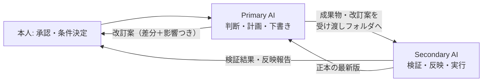

# muse-gemini-ops — DRAFT v1.0

> **ドラフトです。公開していません。** ライセンスは CC BY 4.0、リポジトリ名は muse-gemini-ops に決定済みです。
> 公開前に `REVIEW.md` のチェックリストと本人のレビューを通すこと。

2つのAIアシスタントを役割分担させて運用するための、最小構成のノウハウ集です。
Markdown中心・無料で使えることを前提にしています。

## 公開の方針（決定済み・2026-11-22）

内容は次のとおり。

- リポジトリ名: `muse-gemini-ops`
- ライセンス: CC BY 4.0（`LICENSE` は CC BY 4.0 の全文に差し替え済み）
- ベース: キット v0.13（v0.14 の差分は未反映）
- 言語: 日本語＋英語で公開する方針。現時点のドラフトは日本語のみで、英語版の翻訳は未実施
- v1.0 のスキル: コア6件（core、safety-gate、verification、report-format、qa-check、resource-cap）。`design-first` と `pub-security-check` は v1.1 以降の候補とする
- 試行中の自動実行の例外: v1.0 には含めない。試行の判定後に「検証済みパターン」として追加する

## 役割分担

内容は次のとおり。

- **Primary AI（主系）**: 判断・計画・起案・調査・下書き作成を担当する
- **Secondary AI（副系）**: 実行基盤（定常ジョブ、ブラウザ操作、ファイル連携、デプロイ）と、正本への最終反映を担当する
- **本人**: すべての最終承認と条件決定を持つ（説明責任は常に本人に残る）

> 具体例（筆者の環境）: 本リポジトリが想定する公開時点の体制では、主系が Muse、副系が Gemini である。なお、その後に主従を入れ替える移行を決定し、試行運用中は主系が Gemini、副系が Muse となっている。移行の判定が終わるまでは、公開時点の体制と試行中の体制の両方を記録しておく。
> 役割は製品に依存しない設計にしてあるため、他の組み合わせにも置き換えられます。

## 境界（不変）

内容は次のとおり。

- Primary が扱うのは、データの無い単発作業だけである
- 個人・機密データを含む作業は Primary では行わず、止めて本人へ伝える
- 送信・公開・支払い・申込・削除などの承認行為は、どちらのAIも本人の明示的な go なしに行わない
- 正本（運用ルール・スキル・仕様書）の更新は、差分と影響を添えた改訂案として出し、本人の承認を経て Secondary が反映する

## 構成

内容は次のとおり。

| ファイル | 内容 |
|---|---|
| `README.md` | 全体像・役割分担・目次・免責 |
| `LICENSE` | ライセンス（CC BY 4.0 全文） |
| `docs/01_architecture.md` | 親/子モデル・権限境界・正本管理の考え方 |
| `docs/02_workflow.md` | 日常の運用サイクル・引き継ぎ手順 |
| `docs/examples/article-draft-flow.md` | ケーススタディ: 記事・日報の下書きフロー（4点セット） |
| `docs/03_naming-and-logs.md` | フォルダ構成・命名規則・フラグメントログ設計 |
| `docs/04_safety-and-qa.md` | 安全ゲート・検証手順・公開前チェック基準 |
| `skills/` | 公開用に抽象化したスキル定義（v1.0 はコア6件。`design-first` と `pub-security-check` は v1.1 以降の候補） |
| `templates/` | 運用メモ・更新待ち管理・ログの空テンプレート |

## 前提環境

内容は次のとおり。

- 共有ストレージ（クラウドドライブ等）に、両AIが読み書きできるフォルダを3つ用意する。詳細は `docs/01_architecture.md` を参照
- 両AIとも、作業前に正本の最新版と更新待ち一覧を読み直す
- 従量課金・無料枠のある外部資源を使う作業は、開始前に上限（消費量ベース・金額換算つき）、計量方法、停止条件を決める

## 使い方

内容は次のとおり。

1. `templates/operations-memo-template.md` を複製し、自分の境界と制御値を書き込む
2. `skills/` を、使うAIのスキル読み込み方式に合わせて取り込む（平文ファイルの読み込みを推奨）
3. `docs/02_workflow.md` の運用サイクルで1週間まわし、ログを `templates/log-fragment-template.md` で残す
4. 変更は `docs/04_safety-and-qa.md` の変更管理（差分＋影響＋本人承認）に従う

## 免責

内容は次のとおり。

- 本リポジトリは執筆時点の個人運用の記録を一般化したものであり、特定の環境での動作を保証しません
- 各自の環境・契約・法令に合わせて、境界と上限を決めてから使ってください
- サンプル中の名称・数値・フォルダ名はすべてダミーです（`<your-...>` 形式のプレースホルダを自分の値に置き換えてください）
